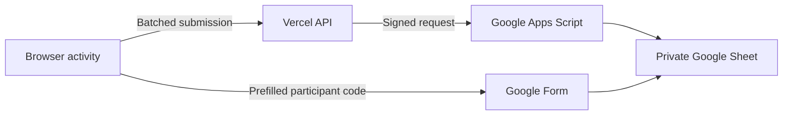

# Catch the Signal

A mobile-friendly browser experiment that measures how predictable visual cues affect people's estimates of elapsed time. I built the activity for Technical Communication research project.

**My contribution:** I developed the browser activity, created the Google Form, and built the integration that saves activity responses and links them to the follow-up questionnaire.

## Try the demo

Download [public/preview.html](public/preview.html) and open it in a modern browser. Complete eight warm-up signals and three short stages, then compare your estimates with the measured times. The demo runs locally and sends no responses.

## What I built

- **A timed activity for phones and computers.** The same task supports a touchscreen response pad, mouse clicks and the Space key. After each stage, participants estimate its duration and rate how predictable it felt.
- **A controlled comparison.** Letters predict either a 600 ms or 1,200 ms delay before a circle. In the more regular condition, the cue predicts the correct delay in eight of ten trials. In the less regular condition, it does so in six. Both conditions contain five short and five long delays. The app shuffles stage order and varies pacing independently of the condition.
- **A timing report.** The browser records stage duration from the first letter to the end of the last circle. The results show measured time, estimated time and estimated minus measured time for each stage and the total.
- **A two-part submission flow.** The app saves the activity first, then opens a Google Form with the participant code already filled in. The code links both parts automatically.

## How it works



The activity uses browser animation frames and a monotonic clock to record elapsed time. Circle visibility stays fixed after a response, so faster taps do not end the trial early. The app records long frame gaps, interruptions and early presses to help assess timing quality.

The browser retains a pending submission so a network failure does not require replaying the activity. A session ID lets the receiver recognise retries and return the existing receipt. The Google Sheet holds session, stage and trial records alongside questionnaire responses.

## Explore the code

| Path | Responsibility |
| --- | --- |
| [public/core.js](public/core.js) | Generate balanced trials and compute timing summaries |
| [public/input.js](public/input.js) | Handle keyboard and pointer input |
| [public/app.js](public/app.js) | Run the activity, measure durations and manage submission |
| [api/](api/) and [lib/](lib/) | Validate incoming requests and sign calls to Google Apps Script |
| [google/Code.gs](google/Code.gs) | Create the Form and Sheet, validate submissions and store results |
| [tests/](tests/) | Check trial balance, input handling, validation and save retries |

The activity uses vanilla HTML, CSS and JavaScript. With Node.js 22 or newer, run:

```sh
npm test
npm run build:preview
```

See the [study protocol](PROTOCOL.md) for the methodology and the [deployment guide](docs/deployment.md) to connect a fresh backend.

## What we learned

In the analysed class study snapshot, 34 matched participants contributed 102 stage estimates. Participants estimated 21.63 seconds on average for stages that lasted 25.53 seconds. The comparison between timing conditions was inconclusive. For this pilot, Google Sheets gave the research team a straightforward way to join data from the two parts of the study.
